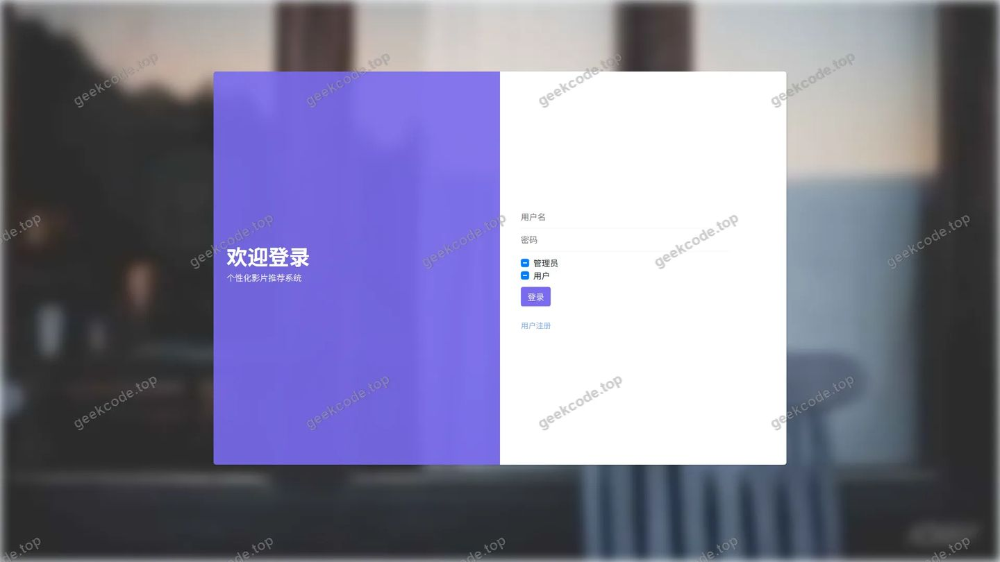
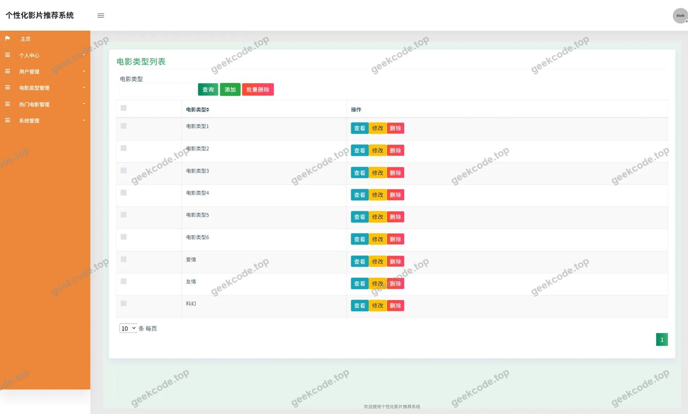
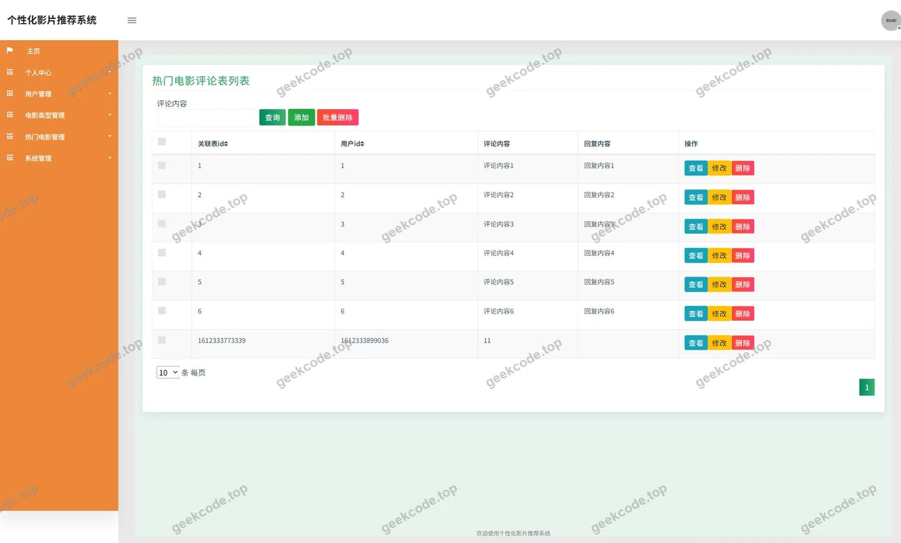
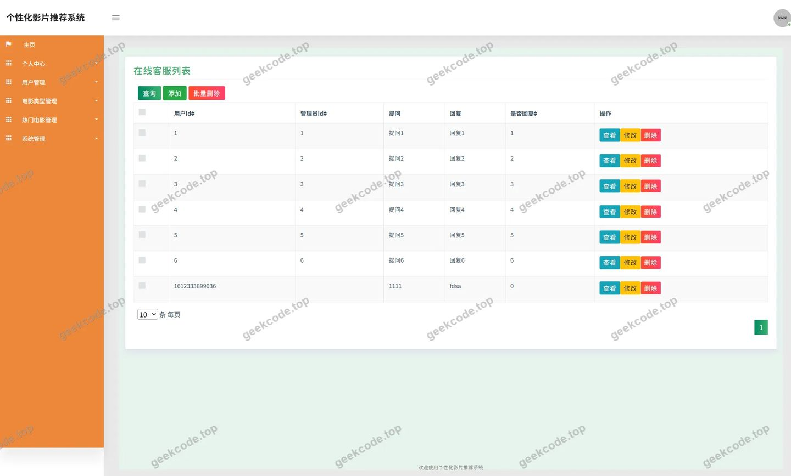
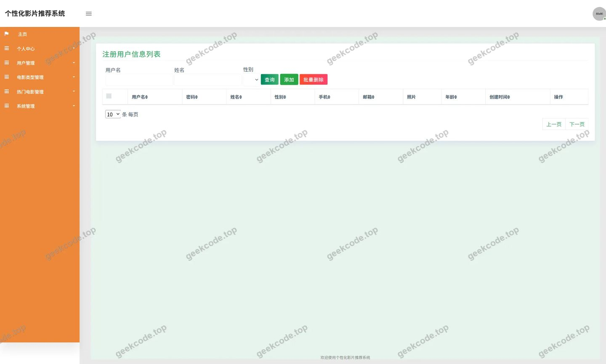
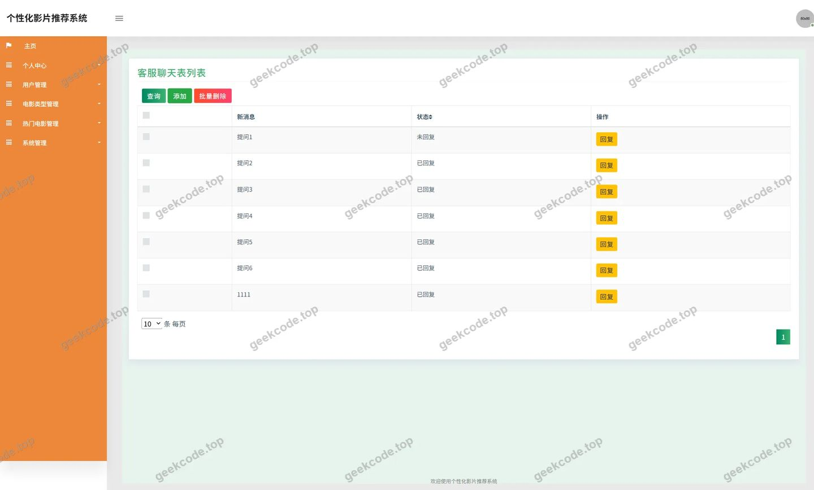
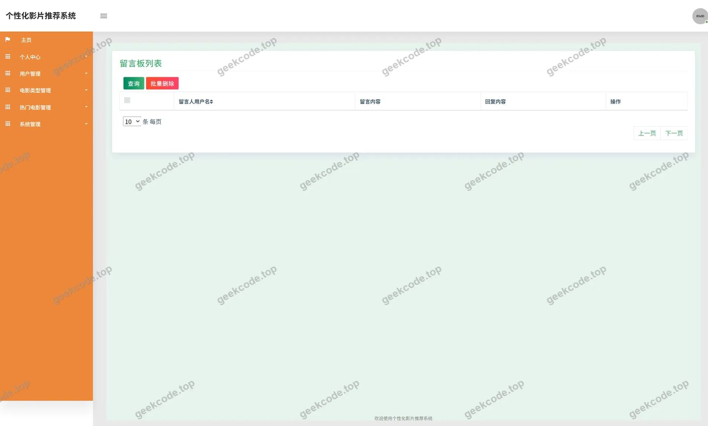
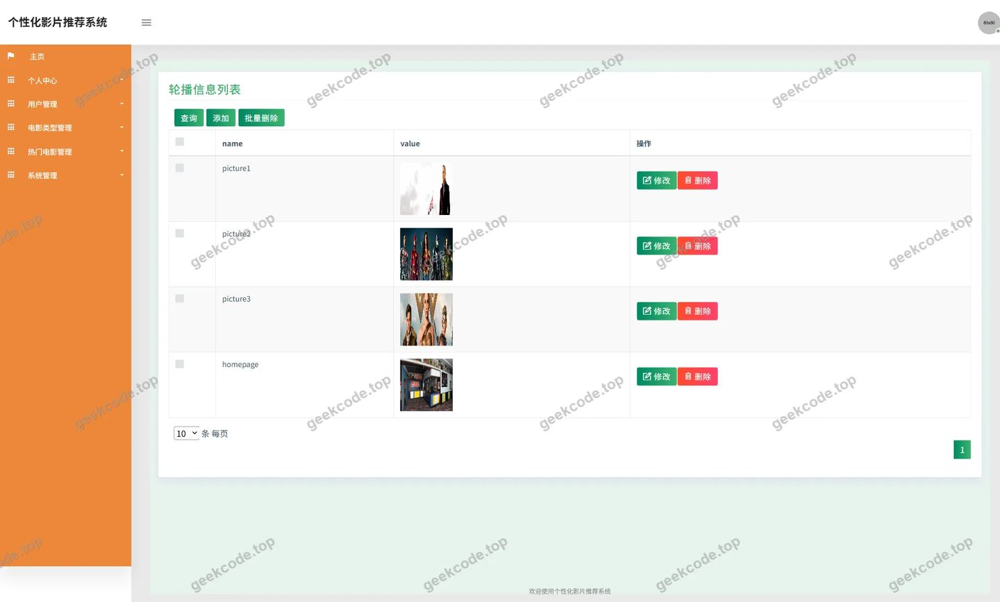
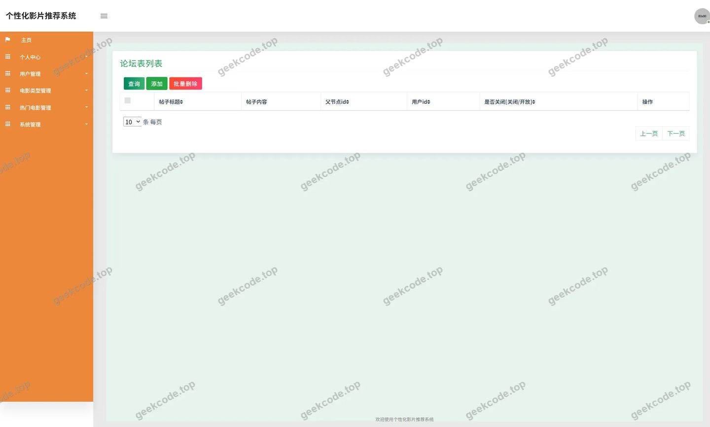

# 个性化影片推荐系统

> 🎓 **计算机毕业设计 · 个性化影片推荐系统**
>
> 本仓库只放**项目介绍 + 运行截图**（截图是站点带水印的原图，存在仓库 `images/` 里）。
>
> 👉 **完整可运行源码 / 数据库脚本 / 部署文档：[点我获取](https://geekcode.top/archives/%E4%B8%AA%E6%80%A7%E5%8C%96%E5%BD%B1%E7%89%87%E6%8E%A8%E8%8D%90%E7%B3%BB%E7%BB%9F?utm_source=github)**
>
> 💬 咨询微信：**ir9372**　|　🌐 更多项目：[极客代码 geekcode.top](https://geekcode.top/?utm_source=github)
>
> 📌 项目详情页：<https://geekcode.top/archives/%E4%B8%AA%E6%80%A7%E5%8C%96%E5%BD%B1%E7%89%87%E6%8E%A8%E8%8D%90%E7%B3%BB%E7%BB%9F?utm_source=github>

<table><td width="230" align="center"> <b>扫码加微信 ir9372</b></td><td valign="middle">📦 源码 = 项目介绍 + 全部运行截图 + 数据库 + 部署文档 👉 点上方任意截图，直接跳到 <b>极客代码 geekcode.top</b> 详情页</td></table>

---

<h1>个性化影片推荐系统</h1>
<h2>项目概述</h2>

本项目名为“个性化影片推荐系统”，是一个基于 Java 后端技术栈构建的纯 API 服务系统。项目旨在通过数字化手段管理电影资讯、用户互动及内容推荐，解决传统影视信息分散、用户交互效率低的问题。核心功能涵盖热门电影展示、新闻资讯发布、用户评论互动、收藏管理及个人中心维护。适用人群包括普通电影爱好者（前台用户）及系统管理员（后台运营人员）。技术架构上，采用 Spring Framework 作为核心容器，MyBatis-Plus 进行数据持久层操作，Druid 实现数据库连接池监控与管理，整体设计遵循前后端分离原则，专注于提供稳定、高效的数据接口服务。

<h2>技术架构</h2>
<h3>后端架构</h3>

系统后端完全基于 Java 语言开发，采用经典的 MVC 分层架构模式：

<ol>
<li><strong>控制层 (Controller)</strong>：由 <code>ChatController</code>、<code>NewsController</code>、<code>RemendianyingController</code> 等组件构成，负责接收 HTTP 请求并分发业务逻辑。</li>
<li><strong>业务逻辑层</strong>：依托 Spring Context 和 Spring Tx 实现依赖注入与事务管理，确保数据操作的原子性与一致性。</li>
<li><strong>数据访问层 (DAO)</strong>：使用 MyBatis-Plus 框架简化 CRUD 操作，结合 Spring JDBC 底层支持，实现高效的数据库交互。</li>
<li><strong>基础设施</strong>：集成 Druid 连接池以优化数据库资源分配，利用 Spring AOP 处理日志记录或权限校验等横切关注点。</li>
</ol>
<h3>数据库设计要点</h3>

根据控制器命名推断，数据库主要包含以下实体表结构：

<ul>
<li><strong>用户相关</strong>：<code>Yonghu</code> (用户表)，存储账号基本信息。</li>
<li><strong>内容相关</strong>：<code>Dianyingleixing</code> (电影类型表)、<code>Remendianying</code> (热门电影/推荐电影表)、<code>News</code> (新闻资讯表)。</li>
<li><strong>交互相关</strong>：<code>Discussremendianying</code> (电影评论表)、<code>Storeup</code> (收藏表)、<code>Luntan</code> (论坛/留言表，推测自截图中的 luntanguanli/liuyanbanguanli)。</li>
<li><strong>配置相关</strong>：<code>Config</code> (系统配置表)、<code>File</code> (文件上传记录)。</li>
</ul>
<h3>核心技术选型理由</h3>
<ul>
<li><strong>Spring Framework</strong>：提供成熟的 IOC 和 AOP 机制，降低模块耦合度，提升代码可维护性。</li>
<li><strong>MyBatis-Plus</strong>：在保留 MyBatis 灵活性的基础上，提供通用 Mapper 和条件构造器，显著减少样板代码，提高开发效率。</li>
<li><strong>Druid</strong>：阿里开源的高性能数据库连接池，具备强大的监控功能，有助于排查 SQL 执行问题和优化数据库性能。</li>
</ul>
<h2>功能模块</h2>

由于该项目为 pure-api 类型且无独立前端路由定义，功能模块主要体现为后端提供的 API 服务能力，配合截图所示的管理界面逻辑，具体模块如下：

<h3>前台用户端功能 (API 支撑)</h3>
<ol>
<li><strong>用户认证与管理</strong>：</li>
</ol>
<ul>
<li>登录/注册接口 (<code>UserController</code>)：处理用户身份验证。</li>
<li>个人信息修改：支持用户更新个人资料。</li>
</ul>
<ol start="2">
<li><strong>影视内容浏览</strong>：</li>
</ol>
<ul>
<li>热门电影列表查询 (<code>RemendianyingController</code>)：获取首页推荐的热门影片数据。</li>
<li>电影分类筛选 (<code>DianyingleixingController</code>)：按类型检索电影。</li>
<li>新闻资讯阅读 (<code>NewsController</code>)：获取最新的影视行业新闻。</li>
</ul>
<ol start="3">
<li><strong>用户互动功能</strong>：</li>
</ol>
<ul>
<li>发表评论 (<code>DiscussremendianyingController</code>)：用户对特定电影进行评分或文字评论。</li>
<li>收藏管理 (<code>StoreupController</code>)：添加或取消对电影/文章的收藏。</li>
<li>在线客服/聊天 (<code>ChatController</code>)：提供基本的消息通信接口。</li>
</ul>
<h3>后台管理端功能 (API 支撑)</h3>

根据截图中的管理页面名称，后端需提供对应的管理接口：

<ol>
<li><strong>基础数据管理</strong>：</li>
</ol>
<ul>
<li>电影类型管理：增删改查电影类别。</li>
<li>热门电影管理：维护推荐位影片信息。</li>
<li>新闻管理：发布、编辑、删除新闻资讯。</li>
</ul>
<ol start="2">
<li><strong>用户与社区管理</strong>：</li>
</ol>
<ul>
<li>用户管理：查看用户列表，重置密码或禁用账号。</li>
<li>评论管理：审核或删除违规的电影评论。</li>
<li>论坛/留言管理 (<code>luntanguanli</code>, <code>liuyanbanguanli</code>)：管理用户发布的帖子或留言板内容。</li>
</ul>
<ol start="3">
<li><strong>系统配置管理</strong>：</li>
</ol>
<ul>
<li>轮播图管理 (<code>lunbotuguanli</code>)：配置首页展示的幻灯片图片。</li>
<li>客服管理 (<code>kefuguanli</code>)：配置客服人员账号或自动回复规则。</li>
<li>文件管理 (<code>FileController</code>)：处理图片、视频等资源的上传与存储。</li>
</ul>
<h2>用户角色与权限</h2>

系统主要划分为两类角色，不同角色拥有不同的 API 访问权限：

<h3>1. 普通用户 (前台用户)</h3>
<ul>
<li><strong>访问范围</strong>：仅限公开的内容浏览及个人中心功能。</li>
<li><strong>具体权限</strong>：</li>
<li><strong>浏览</strong>：查看热门电影、新闻资讯、电影类型列表。</li>
<li><strong>互动</strong>：发表电影评论、参与论坛讨论、收藏喜欢的影片或文章。</li>
<li><strong>个人管理</strong>：修改个人资料、查看我的收藏、修改登录密码。</li>
<li><strong>受限</strong>：无法访问后台管理接口，无法直接修改系统配置或他人数据。</li>
</ul>
<h3>2. 系统管理员 (后台管理者)</h3>
<ul>
<li><strong>访问范围</strong>：拥有全系统的最高权限，可通过管理界面调用后台 API。</li>
<li><strong>具体权限</strong>：</li>
<li><strong>内容运维</strong>：新增、编辑、删除电影类型、热门电影、新闻资讯。</li>
<li><strong>用户治理</strong>：查看所有注册用户信息，执行封号或解禁操作。</li>
<li><strong>社区监管</strong>：审核、删除用户发表的评论、论坛帖子及留言。</li>
<li><strong>系统配置</strong>：上传和管理轮播图素材，配置客服参数，管理系统全局配置文件。</li>
<li><strong>数据统计</strong>：虽然截图中未明确展示图表，但通常管理员可查看用户增长或内容热度等基础统计信息（基于 Controller 存在性推断，若无专门报表 Controller 则此项可能仅为基础列表查看）。</li>
</ul>
<h2>项目特色与创新点</h2>
<ol>
<li><strong>轻量级高并发架构</strong>：摒弃了传统 JSP 模板渲染，采用 Pure-API 模式，前端与后端彻底解耦。这种架构使得后端专注于业务逻辑与数据处理，能够轻松适配 Web 端、移动端 App 或小程序等多种客户端形态。</li>
<li><strong>精细化内容运营管理</strong>：通过独立的 <code>DiscussremendianyingController</code> 和 <code>StoreupController</code>，实现了内容与互动的分离管理。系统不仅提供静态的电影信息，还构建了动态的用户评价体系（评论）和个人兴趣库（收藏），增强了用户的粘性和活跃度。</li>
<li><strong>模块化配置扩展性</strong>：引入 <code>ConfigController</code> 和 <code>FileController</code>，将系统运行参数和资源存储抽象为独立模块。这使得在不重新编译代码的情况下，管理员可以灵活调整首页轮播图、新闻置顶项等展示策略，提升了系统的可维护性和运营灵活性。</li>
<li><strong>完善的社区治理闭环</strong>：从截图可见的“留言管理”、“论坛管理”、“评论管理”等功能来看，系统设计考虑了 UGC（用户生成内容）的风险控制，提供了从发布到审核的全链路管理能力，保障了平台内容的健康有序。</li>
</ol>
<h2>部署环境</h2>

为确保“个性化影片推荐系统”正常运行，需准备以下软件环境：

<table>
<thead>
<tr>
<th align="left">组件</th>
<th align="left">版本要求</th>
<th align="left">说明</th>
</tr>
</thead>
<tbody><tr>
<td align="left"><strong>JDK</strong></td>
<td align="left">JDK 8 或 JDK 11+</td>
<td align="left">Java 运行时环境，建议优先使用 LTS 版本以保证稳定性。</td>
</tr>
<tr>
<td align="left"><strong>MySQL</strong></td>
<td align="left">MySQL 5.7 或 8.0+</td>
<td align="left">关系型数据库，用于存储用户、电影、评论等核心数据。需初始化对应的 Schema。</td>
</tr>
<tr>
<td align="left"><strong>Maven</strong></td>
<td align="left">3.6+</td>
<td align="left">项目管理工具，用于依赖下载和项目打包构建。</td>
</tr>
<tr>
<td align="left"><strong>IDE</strong></td>
<td align="left">IntelliJ IDEA / Eclipse</td>
<td align="left">开发调试工具（可选，生产环境无需安装）。</td>
</tr>
<tr>
<td align="left"><strong>Web 服务器</strong></td>
<td align="left">Tomcat 8.5+ / Jetty</td>
<td align="left">应用服务器，用于部署 Spring Boot WAR 包或运行内嵌容器。</td>
</tr>
<tr>
<td align="left"><strong>操作系统</strong></td>
<td align="left">Linux (CentOS/Ubuntu) / Windows Server</td>
<td align="left">生产环境推荐使用 Linux 以获得更好的性能和安全性。</td>
</tr>
</tbody></table>

<strong>注意</strong>：由于项目未提及 Node.js 或微信开发者工具的具体依赖，且定位为 Pure-API，前端页面若存在则需单独部署静态资源服务器（如 Nginx），此处仅列出后端核心运行环境。

<h2>五、技术特性</h2>
<ul>
<li>使用 MyBatis-Plus 简化数据访问层开发</li>
</ul>
<h2>六、功能模块截图</h2>
<h3>后台管理端</h3>
<h4>页面-登录</h4>

<h4>页面-电影类型</h4>

<h4>页面-热门电影评论</h4>

<h4>页面-用户</h4>

<h4>页面-defaultuser</h4>

<h4>页面-kefuguanli</h4>

<h4>页面-liuyanbanguanli</h4>

<h4>页面-lunbotuguanli</h4>

<h4>页面-luntanguanli</h4>

---

## 获取完整源码

| 项目 | 说明 |
| --- | --- |
| 项目名 | 个性化影片推荐系统 |
| 运行截图 | 本文 9 张（站点带水印原图，仓库 `images/` 目录） |
| 完整源码 | [https://geekcode.top/archives/%E4%B8%AA%E6%80%A7%E5%8C%96%E5%BD%B1%E7%89%87%E6%8E%A8%E8%8D%90%E7%B3%BB%E7%BB%9F?utm_source=github](https://geekcode.top/archives/%E4%B8%AA%E6%80%A7%E5%8C%96%E5%BD%B1%E7%89%87%E6%8E%A8%E8%8D%90%E7%B3%BB%E7%BB%9F?utm_source=github) |
| 咨询微信 | **ir9372**（备注：jingpin-yuanma） |
| 更多项目 | [极客代码 geekcode.top](https://geekcode.top/?utm_source=github) |

> 需要源码、部署、改配置、跑不起来等问题，加微信 ir9372 沟通，说明项目名即可。
